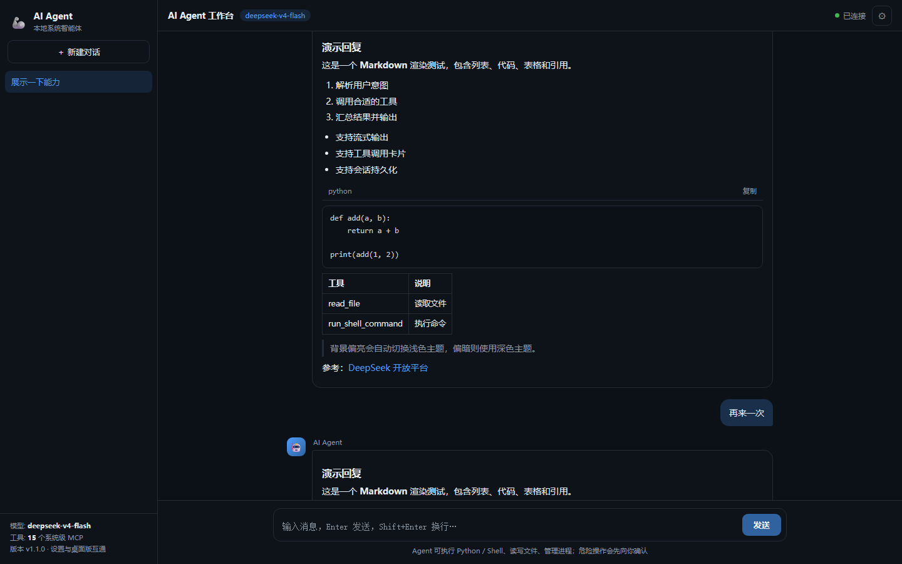
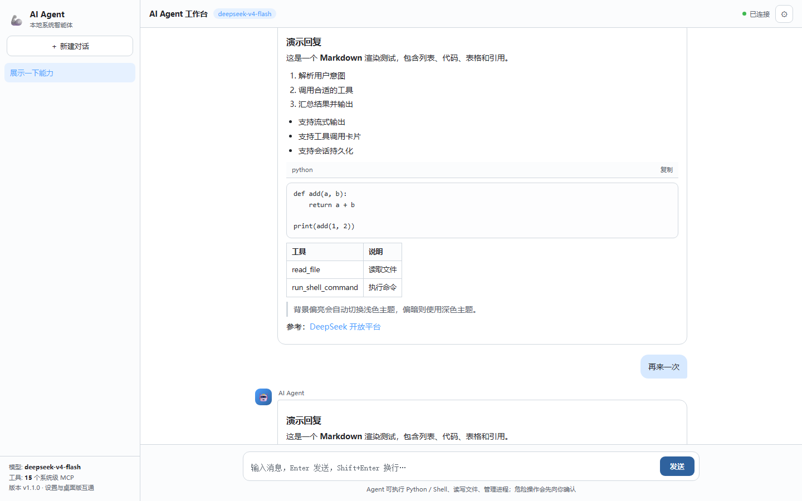

# 本轮审视与重构说明

> 目标：在不改变"本地 AI Agent + MCP 工具 + 双端界面"定位的前提下，消除重复实现、
> 修复实际缺陷、补齐缺失能力，并让改动可验证。

## 一、结论速览

| 维度 | 改动前 | 改动后 |
|---|---|---|
| 核心逻辑 | `chat.py` / `webui.py` 各一份提示词、工具转换、循环 | 统一到 `agent_core.py`（AgentRunner 可注入 client，便于测试） |
| 会话 | 内存态，刷新/重启即丢；每个标签页拉一个 MCP 进程 | `data/sessions/*.json` 持久化；全进程复用一个 MCP 连接 |
| 停止生成 | 不支持 | 支持；工具执行中停止会结束工具进程树 |
| 设置互通 | 桌面端写 PascalCase、网页端读 snake_case，**实际不互通** | 统一 camelCase，读取兼容三种写法，环境变量不落盘 |
| 工具执行 | `exec` 在 MCP 进程内跑，死循环会永久卡死；cmd 输出 UTF-8 解码导致乱码 | 独立子进程 + 超时杀进程树 + 多编码解码 + 输出上限 |
| 稳定性 | 无重试、无步数上限、无上下文裁剪 | 瞬时错误重试、单轮最多 24 次工具调用、超长历史自动裁剪 |
| 网页前端 | 每次 token 全量重渲染；列表 Markdown 生成非法嵌套；无停止/删除/重连 | rAF 节流、重写 Markdown（含表格/复制）、停止/删除/自动重连 |
| 多端一致性 | 同一会话多标签页各显示各的 | 服务端 `user_message` 回显 + 按 sid 分发事件 |
| 安全 | 任意网页可直连 `ws://127.0.0.1:8000/ws` 驱动 Agent | HTTP/WS 校验 Origin，拒绝非本机来源 |
| 可维护性 | 无测试、无 lint 配置、`.gitignore` 是 UTF-16（Git 无法识别） | 42 个 pytest（含端到端）、ruff 配置、`.gitignore` 改为 UTF-8 |
| 发布产物 | 桌面快捷方式指向已不存在的 `AI-Agent - rc1`，dist 为旧版本 | 快捷方式指向当前 `dist`，dist 已按新源码重新发布 |

## 二、发现的问题与处理

### 严重（会导致功能失效/安全风险）

1. **双端设置不互通**
   - 现象：桌面版保存的 API Key，网页版仍提示"未配置"。
   - 原因：`Settings.cs` 用 `System.Text.Json` 默认 PascalCase 写 `Model/ApiKey`，
     `webui.py` 读 `model/api_key`；两套键互不相认。
   - 处理：C# 写 camelCase + 大小写不敏感读取 + 数值/颜色归一化；Python 侧读取兼容
     camelCase/snake_case/PascalCase，写盘统一 camelCase（`SettingsManager`）。
   - 验证：`test_settings_accept_legacy_pascal_case`、`test_settings_manager_merges_...`。

2. **WebSocket 无来源校验（本地 Agent 可被任意网页驱动）**
   - 现象：任意网站 JS 可连 `ws://127.0.0.1:8000/ws`，借用户机器执行命令。
   - 处理：HTTP 中间件 + WS 握手校验 `Origin`，只允许 `127.0.0.1` / `localhost` / `::1`；
     桌面客户端不带 Origin，予以放行。
   - 验证：端到端测试与查看 `/ws` 代码路径；非本机 Origin 会 403/1008。

3. **`run_python_code` 在 MCP 进程内 `exec`**
   - 现象：模型生成 `while True` 会永久占住 MCP 服务，之后所有工具都无法响应。
   - 处理：改为独立子进程（`python -` 从 stdin 读代码）+ 超时 + `taskkill /T` 杀进程树 +
     输出上限；子进程崩溃/死循环不再影响服务。
   - 验证：`test_run_python_code_timeout`、`test_run_python_code_captures_traceback`。

4. **中文环境下 shell 输出乱码**
   - 现象：`cmd` 以 cp936 输出，被按 UTF-8 解码成 `���IJ���`。
   - 处理：`decode_process_output()` 依次尝试 UTF-8 / 系统代码页 / GB18030。
   - 验证：`test_shell_output_is_decoded_as_gbk`。

5. **桌面端 WebSocket 接收假设"一帧一条消息"**
   - 现象：历史消息较大或分片时 JSON 被截断，界面异常。
   - 处理：累积到 `EndOfMessage` 再解析；未知消息类型忽略，保证向前兼容。
   - 验证：Debug x64 构建通过；发送大历史（会话恢复）走同一路径。

### 高（影响体验/数据）

6. **会话不持久化，每个标签页一个 MCP 进程**
   - 处理：`SessionStore` 按会话存 JSON（原子写、非法 sid 拒绝、损坏文件跳过）；
     `McpBridge` 全进程复用连接，失败自动重置重连。
   - 验证：端到端测试重启会话恢复、`test_session_store_*`。

7. **无法停止生成；长命令只能等超时**
   - 处理：WS 增加 `stop`，取消 asyncio 任务；若处于工具阶段，重置 MCP 连接以结束
     工具进程树；前端/桌面端均有停止按钮。
   - 取舍：停止工具会顺带中断同一进程内其他会话正在跑的工具（单用户场景可接受）。

8. **无最大工具步数/上下文裁剪**
   - 处理：`AgentRunner.max_steps=24`；`trim_messages` 按"完整对话轮次"裁剪，避免留下
     孤立 tool 消息导致 API 400。
   - 验证：`test_runner_stops_at_max_steps`、`test_trim_messages_*`。

9. **无网络重试，错误信息直接抛给用户**
   - 处理：首包前最多重试 2 次（退避 1.2s/2.4s）；401/402/429/5xx 翻译为可操作提示。
   - 验证：`test_runner_retries_transient_error`、`test_runner_reports_api_error`。

10. **桌面端每次启动强制新建会话**
    - 处理：不再发送 `new_chat`，由后端下发 `ready/session/history` 恢复最近会话；
      后端 `fresh_session()` 复用最近空会话，避免堆积空会话。

11. **保存设置会把环境变量里的密钥写进 `settings.json`**
    - 处理：设置文件只写用户显式修改的字段；`api_key_source=env` 时保留文件原值。
    - 验证：`test_env_key_has_priority_but_is_not_persisted`。

12. **`read_file` 的 `max_bytes` 实际按字符计，且无编码回退**
    - 处理：按字节读取、支持 `offset` 分段、UTF-8/GBK 自动识别。
    - 验证：`test_read_file_*`。

13. **`delete_file` 可删项目根/用户目录/磁盘根**
    - 处理：关键目录清单 + 项目目录及其上级保护，即使 `confirm=True` 也拒绝。
    - 验证：`test_delete_requires_confirm_and_guard`。

14. **`.gitignore` 是 UTF-16，Git 不识别**
    - 现象：`.vs/`、`bin/`、`obj/`、日志也进版本库；改动前 `git status` 里大量构建产物。
    - 处理：改写为 UTF-8，并补充常见忽略项。
    - 注意：**已跟踪的构建产物不会自动取消跟踪**。如需清理，执行
      `git rm -r --cached AI-Agent-GUI/bin AI-Agent-GUI/obj AI-Agent-GUI/.vs`（会保留本地文件）。

### 中（体验/可维护性）

15. `chat.py` 无 Key 时直接 `raise ValueError`，模型/地址硬编码 → 改为读共享设置，给出配置指引，新增 `/new`、`/tools`。
16. 三处硬编码"工具: 15 个" → 后端 `ready` 下发真实数量，网页/桌面动态显示。
17. 自研 Markdown 每遇到一个 `-` 就包一层 `<ul>`（非法嵌套）；`**` 跨行匹配错乱 → 重写为按行解析，支持标题/有序无序列表/表格/引用/链接/代码块，并加"复制"。
18. 每个 token 都 `innerHTML = renderMarkdown(whole)` → `requestAnimationFrame` 节流，停止时再最终渲染。
19. 强制滚到底部，用户上翻看历史会被拽回 → 仅在接近底部时自动滚动。
20. 桌面端切浅色主题后标题栏/侧栏仍是深色、部分文字不可读 → 标题栏/侧栏/输入坞/会话列表全部跟随主题，标题栏按钮配色随深浅切换。
21. 网页端改了设置需重启后端 → `SettingsManager` 按 mtime 自动重载。
22. 无健康检查/favicon → 新增 `/healthz`、`/favicon.ico`，并给页面加 `Cache-Control: no-store`。
23. `command.py` 用当前工作目录拼 `.venv` 路径 → 改为基于文件位置解析，找不到 venv 时给出提示；`start.bat` 直接用 `.venv` 启动 chat.py。
24. 同一会话多标签页互不同步，且历史里多条助手消息会挤进同一个气泡 → 服务端广播 `user_message`，前端按 sid 处理并重置气泡；`renderHistory` 每条助手消息新建容器。
25. 根目录桌面快捷方式指向不存在的 `G:\...\AI-Agent - rc1\dist\...` → 指向当前项目 `dist\AI-Agent-GUI\`，并用新源码重新发布 self-contained 产物。
26. 旧 dist 里的桌面端按 PascalCase 读设置，遇到网页版新写的 camelCase 会"丢设置" → 重新发布后使用大小写不敏感读取，彻底消除该问题。
27. **桌面端设置按钮点击无效（"摆设"）** → 根因是 `SetTitleBar(AppTitleBar)` 把包含按钮的整条标题栏都设成拖拽区，按钮点击被系统当成拖动窗口（WindowsAppSDK #2574）。改为只把左侧列 0~3 的非交互区域设为拖拽区，设置按钮位于拖拽区之外；同时给 `ContentDialog.ShowAsync` 加异常兜底，并把点击/异常写入根目录 `gui.log`。已用 UI Automation 真实鼠标点击做 A/B 验证：修复前的 dist 无反应，修复后的 dist 正常弹出设置对话框。

## 三、架构变化

```
改动前                                 改动后
chat.py ── 提示词① / 工具转换①            chat.py ─┐
webui.py ─ 提示词② / 工具转换② / 循环     webui.py ┼─ agent_core.py
server.py ─ exec / 编码 / 截断            server.py ┘   ├ Settings / SettingsManager
                                                       ├ build_system_prompt(tools)
                                                       ├ to_openai_tools
                                                       ├ AgentRunner(async 事件流)
                                                       ├ SessionStore
                                                       └ trim_messages / 解码工具
```

- `webui_page.py`：把 ~550 行内嵌 HTML/CSS/JS 从 `webui.py` 拆出，`render_page()` 注入主题。
- WS 协议新增 `ready` / `stop` / `delete` / `ping` 与 `sid` 字段；旧消息格式保持兼容，
  桌面端忽略未知类型即可运行（本轮桌面端也已跟进并构建通过）。

## 四、验证

| 项 | 结果 |
|---|---|
| `python -m pytest` | **42 passed**（单元 + server 集成 + 真实子进程端到端） |
| `python -m ruff check .` | All checks passed |
| WinUI Debug/Release x64 构建 + self-contained 发布 | 成功，产物在 `dist/AI-Agent-GUI/` |
| 桌面端设置按钮真实点击（UI Automation 模拟鼠标） | 修复前 dist：无反应 / 无日志；修复后 dist：对话框弹出，`gui.log` 记录点击 |
| 网页版深色/浅色渲染 | Edge 无头截图核对（含两轮历史恢复），见 `docs/screenshots/` |





端到端测试实际覆盖的链路：
启动 `webui.py` 子进程 → 模拟 OpenAI SSE → 浏览器侧 WebSocket 客户端 → 模型流式返回
→ 触发 `get_datetime` MCP 工具 → 工具结果回填 → 第二轮回复 → 新建/切换会话 →
断言会话 JSON 落盘与 `/api/settings` 不泄露密钥。

## 五、未做与建议（按优先级）

1. **版本库瘦身**：`AI-Agent-GUI/bin|obj`、`dist/`、`.vs/` 已被跟踪，建议按上文 `git rm --cached`
   清理；`dist/` 若作为发行产物保留，可改用 Releases 管理。
2. **密钥存储**：`settings.json` 目前是明文；可改为 Windows DPAPI（`ProtectedData`）或凭据管理器。
3. **CI**：新增 `windows-latest` 的 GitHub Actions，跑 `uv sync` + `pytest` + `MSBuild`，
   防止双端协议再次漂移（本轮的核心缺陷正是缺少这种检查）。
4. **体积裁剪**：`pyproject.toml` 把 torch/easyocr/gradio 等全部列为必需依赖，安装很重；
   可拆成 `[project.optional-dependencies]`（agent / ocr / data / gui）。
5. **桌面端实机冒烟**：本轮只做到"编译通过 + 协议兼容"，建议在目标机上跑一遍
   启动、发送、停止、设置保存/重启、恢复历史。
6. **工具的 MCP 侧取消**：当前"停止工具"靠重启 MCP 进程实现；更长远的做法是让
   `server.py` 记录子进程并按 MCP `notifications/cancelled` 精确终止。
7. **截图落盘位置**：`take_screenshot` 默认写到当前工作目录，建议改到
   `data/screenshots/<时间戳>.png` 并在界面提供预览。
